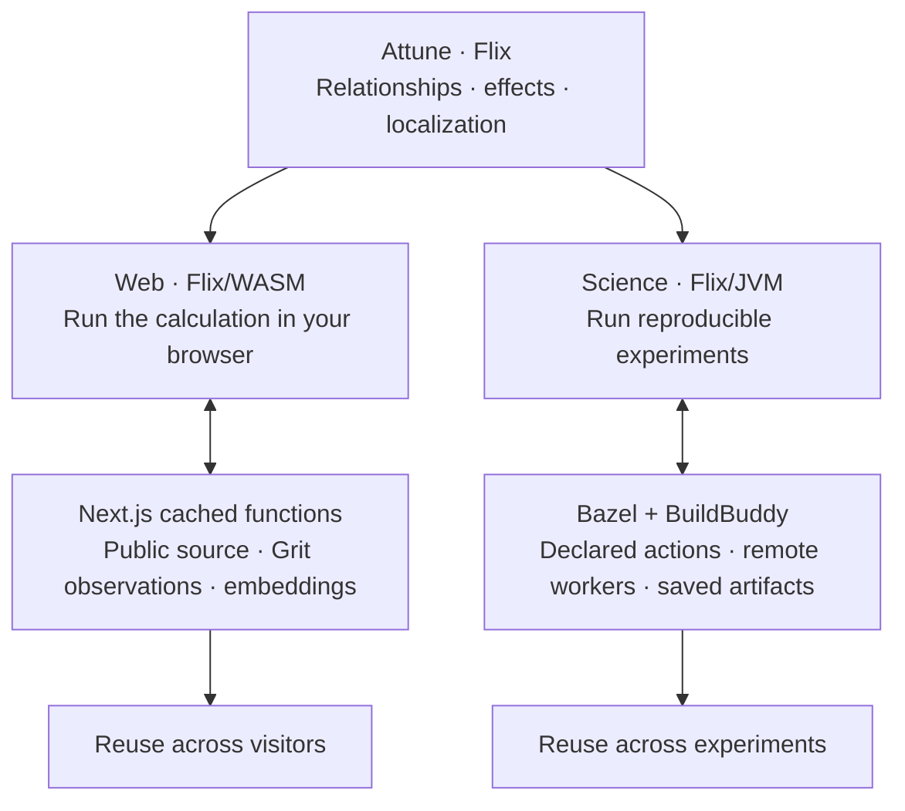

# Attune — Small Programs for Understanding Software

Software repositories repeat a few relationships: files define functions, files
import other files, and functions call other functions. Attune expresses these
relationships as small programs whose results we can inspect and whose work we
can reuse across related questions.

Attune separates a calculation from the expensive work it asks for. The same
Flix code can use a saved answer, a shared web result, or an artifact built for
an experiment. Exact inputs and tests determine when reuse is valid.

## Branch status: Flix/Bazel consolidation mission

This checkout (branch `migration/flix-consolidation-20261016`, base
`d268c9b2b236e229fdcec352c9116dbb7f8c801d`) hosts the 2026-10-16 Flix/Bazel
consolidation mission: the user specification is preserved at
[`mission/ATTUNE_FLIX_BAZEL_DROID_MISSION_2026-10-16.md`](mission/ATTUNE_FLIX_BAZEL_DROID_MISSION_2026-10-16.md),
and the mission ledgers live at the repo root —
[`BASE_SELECTION.md`](BASE_SELECTION.md), [`ARCHITECTURE.md`](ARCHITECTURE.md),
[`RESPONSIBILITIES.md`](RESPONSIBILITIES.md),
[`LANGUAGE_BOUNDARIES.md`](LANGUAGE_BOUNDARIES.md),
[`JAVA_SEAMS.md`](JAVA_SEAMS.md), [`SIZE_AND_CLOSURE.md`](SIZE_AND_CLOSURE.md), and
[`VALIDATION.md`](VALIDATION.md).

Current state (M0): the working sources are the frozen pre-Nim baseline; no application
rewrite has happened yet, and the executable source-policy gates arrive with M1 — the
new `nix run .#lint` / `.#typecheck` / `.#test` entry points **do not exist yet** and
must not be assumed. Known baseline failure, preserved as found: the public
`bazel test //...` gate currently fails at loading (`novelty_batches.bzl` /
`quality_batches.bzl` / `scale_batches.bzl` are absent from the frozen tree); the repair
is planned M1 work and is not suppressed. Safe pinned commands meanwhile are the
development commands in [`attune/AGENTS.md`](attune/AGENTS.md) (`nix run`,
`nix run .#test` in `attune/`, saved-answer, no provider) and the manifest commands in
the mission's `services.yaml`, which pin Bazel 8.6.0 and a dedicated output base. The
original, Nim-era, and campaign checkouts are read-only references; never reset, clean,
or stage in them.

## One program, two execution models



**Same meaning. Different scheduling.** The website aims to avoid repeating
expensive work for each visitor. Experiments aim to run independent work in
parallel and keep unchanged results. Neither needs a second ranking algorithm.

An effect makes the boundary explicit. Flix asks for an embedding of exact
text, using a specified model and recipe. An adapter obtains the answer; a
handler supplies it to the calculation. The calculation does not need to know
whether that answer came from a provider or a previous run.

The boundary is tested: server Grit is compared with native extraction, and
browser Flix is compared with JVM execution. This is equivalence over tested
operations, not every runtime feature: **native Datalog remains JVM-only**.
Next's expiring runtime cache and Bazel's action cache also have different
lifetimes. An effect alone provides neither caching nor concurrency.

[Explore the website](https://atlas-live-five.vercel.app/) ·
[Read the measured results](https://github.com/becker63/attune/blob/main/LOCALIZATION_REPORT.md) ·
[About the author](https://becker63.digital/)

[One program](#one-program-two-execution-models) ·
[Effects & waits](#effects-waits-and-reused-work) ·
[Experiments](#what-the-experiments-found) ·
[Small programs](#small-programs-over-repository-structure) ·
[Implementation](#implementation) ·
[Reproduce](#reproduce-and-inspect)

## Effects, waits, and reused work

### Five kinds of wait

Reading source, asking a model, and judging a prepared file list take different
amounts of time. Measuring them separately shows where scheduling and reuse
might help. Embeddings turn file text into numbers for retrieval.


| Measured job | Observations | Median | What the timer includes |
| --- | ---: | ---: | --- |
| File embeddings | 351 | 2.43 s | Synchronous provider SDK request |
| Source extraction | 90 | 93.77 s | Whole remote extraction process |
| Theory preparation | 90 | 20.61 s | Whole remote Theory process |
| Jev judgment | 88 | 0.37 s | Request over an already prepared shortlist |
| Sol inspection | 88 | 28.94 s | Whole repository-inspection turn |

**Read the plot:** boxes contain the middle half; the line is the median;
the diamond is the mean (average). Each dot is a recorded operation. The horizontal scale
is logarithmic: the same distance means ten times longer. Extraction's mean was
344.58 seconds, and its longest process took 42.5 minutes.

These are separate retained measurements, not a concurrent schedule or a
controlled Jev-versus-Sol speedup. The model-turn populations include three issues
outside the 85-task accuracy cohort. [Explore the interactive plot and timer boundaries](https://atlas-live-five.vercel.app/#overview)
or inspect [all observations and source hashes](https://atlas-live-five.vercel.app/wait-classes.json).

### Qwen retrieval: a smaller bill, reusable work

Qwen ranks files using embeddings: numeric descriptions of their contents.
Across the retained acquisition for **88 tasks**, its reported provider charge
was **$0.141**, compared with **~$4.65 estimated** for GPT-6.1-Sol, medium,
inspecting repositories.

| Workflow | Known model spend | Compared with the Sol estimate |
| --- | ---: | ---: |
| Qwen retrieval | $0.141 | **33× lower** |
| Qwen + structural context + Jev judgment | $0.165 | **28× lower** |
| Sol repository inspection | ~$4.65 API-equivalent estimate | Reference |

On the **85 accuracy-eligible tasks**, Qwen found at least one required file
within ten in **85.9%** of cases, versus **76.5%** for Sol. Adding structural
context and Jev raised that to **91.8%**. Sol put a required file first more
often; Qwen alone recovered every required file less often. These are different
answering procedures, not a quality-matched contest.

The reusable part matters: cold acquisition made **351 embedding requests**;
an unchanged warm replay made **zero**. No warm wall time was recorded.
Sol ran on a ChatGPT subscription; its dollar figure estimates an API bill from
recorded usage. These comparisons exclude source analysis, local work, and
computer costs. They measure model spend, not whole-job latency.

Jev adds a small judgment after retrieval. Its median request took 0.37 seconds,
versus 28.94 seconds for Sol's whole inspection turn; preparation lies outside
that Jev timer. [Receipts and price assumptions](https://atlas-live-five.vercel.app/costs.json) ·
[Explore retrieval, costs, and reuse](https://atlas-live-five.vercel.app/#benchmark).

### Make expensive work explicit

An **effect** is a request for outside work: read a file, launch a process, ask a
provider. Separating that request from the calculation lets us decide how to
perform it and which saved answers remain valid.

```text
source -> facts   -> structural questions ─┐
       -> vectors -> candidate retrieval ──┼-> prepared judgment -> evaluation
issue  -> vector ─────────────────────────┘
```

- **Keep unaffected work.** Another issue can reuse exact file vectors and
  source facts while supplying its own question and judgment.
- **Schedule independent work.** Bazel declares dependencies; BuildBuddy can
  execute independent actions remotely rather than waiting for each in turn.
- **Replay exact inputs.** Retained answers let us change deterministic processing
  without buying the same provider response again.

An effect declaration alone does not cache or parallelize a program. Exact
identity, declared dependencies, and tested boundaries make those choices safe.
Start with [Effects.flix](attune/src/Attune/Effects.flix): its file-finding function
asks for vectors, while a handler supplies exact saved answers. The default
walkthrough uses authored vectors; the reported measurements come from the
archived studies. Provider SDK calls remain a separate boundary.

**Measured scheduling result, historical AttuneFlix:** for 61 completed JS/TS
SWE-Explore cases, 4,301.12 seconds of sequential evaluation shard work became
51.70 seconds of cold remote wall time; the unchanged warm graph took 0.153
seconds. Outputs were preserved at the frozen numeric tolerance. Exact replay
made no new provider calls. This is an offline evaluation result, not a live
coding-agent speedup or a timing of the current Flix implementation.
[Sealed report and usage](https://github.com/becker63/attuneflix/tree/main/experiments/swe-explore-js-ts-scale).

## What the experiments found

### Localization: finding the files

Given an issue, can retrieval plus structural post-processing find the existing
files its reference fix changes? The retained SWE-rebench-V2 JS/TS comparison
scored **85 eligible tasks in 22 repository groups**:

| Condition | First file correct (Hit@1) | A required file in top 10 (Hit@10) |
| --- | ---: | ---: |
| P: issue/path token overlap | 11.8% | 35.3% |
| PA: + exact-name anchor bonuses | 18.8% | 41.2% |
| PAD: + import and structural-witness bonuses | 12.9% | 41.2% |
| CodeRankEmbed file retrieval | 18.8% | 45.9% |
| Hosted Qwen retrieval | 41.2% | 85.9% |
| Qwen + Jev reranking | 57.6% | 90.6% |
| Qwen + structural context + Jev | 61.2% | 91.8% |
| Inspected GPT-6.1-Sol (different answer protocol) | 70.6% | 76.5% |

These first three rows are **fixed, hand-written scoring rules**, not BM25.
“Prior” means the starting score before structural evidence is added; it is not
a learned probability. For every candidate file, the historical implementation:

1. Lowercases the issue and file path, splits them into runs of letters, digits,
   or underscores, discards tokens shorter than three characters, and removes
   duplicates. It adds **one point per distinct issue token also present in the
   path**. It does not search the file body, count repeated words, apply inverse
   document frequency, or normalize by document length.
2. Resolves issue tokens to **anchors**: a token must name exactly one declared
   file basename (without its extension) or exactly one declared symbol under
   the selected exact-name policy. Missing or ambiguous matches add nothing.
   It adds **two points per anchor hosted by the candidate**: the named file
   itself, or the file that defines the named symbol.
3. In the facts arm, adds **one point per anchored file connected to the
   candidate by a direct import**, in either direction. This bonus uses file
   anchors; it does not first turn every symbol anchor into its owning file.
4. In the Theory arm, also adds **one point per materialized structural witness
   row connecting the candidate file to an anchor**. Here a witness is a result
   of a bounded query over the extracted relationships, such as a typed
   two-edge chain—not a model's explanation.

The cumulative scores are `P = path matches`, `PA = P + anchor bonuses`,
`PAF = PA + import bonuses`, and `PAD = PAF + witness bonuses`. Files sort by
score descending, then path ascending for ties. The README table shows P, PA,
and PAD; the intermediate PAF arm reached 16.5% Hit@1 and 41.2% Hit@10.
All candidates remain in the ranking, including files with score zero.

For example, in an **illustrative** repository, an issue mentioning `total`
gives `src/total-utils.ts` one path-match point. If `total` names exactly one
symbol, defined in `src/pricing.ts`, the anchors arm gives `pricing.ts` two
points even though its path does not contain `total`. That is the extra
mechanism behind “issue-to-code anchors.” These historical anchors are names
resolved from issue text; later experiments also use “anchors” for Qwen's
highest-ranked files, a different procedure.

[Exact historical scoring implementation](https://github.com/becker63/attune/blob/c0ed1329/attune/src/Attune/Study.flix#L2963)
· [Detailed method explanation](https://becker63digital.mintlify.site/experiments/localization).

Atlas supplies structural context **after retrieval**; it does not replace the
retriever. The results are mixed: richer deterministic scoring hurt top-one
accuracy, while structural context in the hosted reranking prompt helped on this
population. Finding any required file is easier than finding the complete fix:
the last condition recovered **all required files in the top 10 on 55.3% of tasks**.

**CodeRank comparison.** On this historical panel, Qwen outperformed our
CodeRankEmbed baseline under the evaluated file-ranking recipes. These are
retrieval results, not results from the current structural-program search.
We tested individual source-file embeddings, without the separate CodeRankLLM
reranker; the [CodeRank paper](https://arxiv.org/html/2412.01007v3) evaluates
function retrieval and reranking on a different workload. This comparison does
not establish superiority over the full CodeRank system.

[CodeRankEmbed](https://huggingface.co/nomic-ai/CodeRankEmbed) learns a ranking
representation from text. Attune's structural investigation asks which small
procedures improve an existing ranking, and where their effects repeat. A
stronger retriever can supply better anchors for those procedures; the two
approaches can be combined. [Historical results and scope](LOCALIZATION_REPORT.md).

This was exploratory. Eight of the original 96 tasks were excluded because two
groups did not finish within the runtime cap; three of the remaining 88 had no
eligible gold. The final split has only 15 eligible tasks in four groups.
The inspected Sol arm reached 60/85 top-one hits under a different answer protocol
over its own returned files, rather than the ranking arms’ common candidate universe,
with 20/88 read-floor failures retained as misses.

Historical Qwen acquisition reported $0.1409903; the two Qwen/Jev conditions
reported $0.015136548 and $0.023915388 for judgment, excluding other arms and
compute. Warm embedding replay made zero provider requests; its receipt left
cost and local wall time unavailable.

[Watch successes and regressions](https://atlas-live-five.vercel.app/#localization) ·
[Read the concise study report](https://github.com/becker63/attune/blob/main/LOCALIZATION_REPORT.md) ·
[Inspect the frozen tables](https://github.com/becker63/attune/tree/main/evidence)

### Coordination: dividing work between agents

Can we organize a repository so several agents can change it independently in
one checkout? Coordination uses the same code connections as localization to
**divide work between agents**.

Instead of ranking files, it asks whether two changes touch the same boundary:

```text
change A + change B + repository facts
                 |
                 v
     structural witness -> parallel / coordinate / unknown
```

The goal is parallel work: give agents separate pieces when the evidence supports
it, and coordinate them when changes overlap. The explanation for a split is not
a guarantee against conflicting edits. The rules and execution plans pass tests
on authored examples. The original 32-pair study is unfinished; it has no measured
multi-agent speedup to report.

### ReviewBench: could this make review cheaper?

Localization raised a practical question: could saved knowledge of a repository
reduce an agent's work—and its cost? ReviewBench tested that idea in code review,
comparing ordinary source access with the same source access plus an optional
precomputed evidence bundle, called a **packet**.

A **packet** is our name for a precomputed, source-bearing response to a
specific review question. It combines the changed entrypoints being reviewed,
the review intent, supported contract/reachability cues, unresolved questions,
and **actual source excerpts**. Each excerpt carries its repository world,
base/head revision, path, inclusive line range, SHA-256, byte count, and coverage
status. It is not just a list of graph edges or a generated summary.

Mechanically, the packet condition had one extra tool, `attune_packet_operation`,
while retaining the same ordinary source-reading tools as the plain condition.
The reviewer requested a declared packet ID and a disclosure mode. The tool
looked up the precomputed packet, checked its source identities and permissions,
verified the excerpt bytes, and returned metadata plus source text in bounded
pages, with a continuation cursor when necessary. `progressive` returned the
packet's selected spans; `full-source` expanded to all declared regions of that
changed world. `whole-file` and `region` allowed a particular declared file or
line range to be read. Unsupported cues stayed absent and unanswered questions
stayed explicit. The tool supplied evidence; the reviewer still had to decide
whether the code contained a defect.

[Packet request and response mechanics](https://becker63digital.mintlify.site/experiments/reviewbench)
· [Historical tool implementation](https://github.com/becker63/attune/blob/c0ed1329/attune/platform/dsh/tool/packet_tool.mjs).

Review was a different problem. The agent already starts with a code change;
it must find real defects and explain them. Finding files was a smaller part of
that job. The study did not separately measure how much localization contributed.

| Corrected results: 24 reserved tasks | Plain source access | Packet-assisted condition |
| --- | ---: | ---: |
| Valid findings, final + saved checkpoint | 18 | 17 |
| Known recall, 224 positive references | 36.2% | 27.7% |

A ten-task pilot came first. Across the pilot and later check, the packet tool
was called three times and refused all three requests: the tool boundary
returned errors, so no accepted packet was delivered. This does not mean the
reviewer read a packet and rejected its evidence. The setup did not show a cost-saving
benefit. Final reviews, saved checkpoints, and unresolved judgments are counted
separately in the report.

The later reviews used 6,567,947 tokens; judging their findings used another
276,637. The actual subscription cost is unknown.

[Study report](https://github.com/becker63/attune/blob/main/LOCALIZATION_REPORT.md) ·
[Evidence guide](https://github.com/becker63/attune/tree/main/evidence) ·
[Full historical archive](https://github.com/becker63/attune/blob/e9731b823ff2ea706b1330ea48dc70f2befef311/LOCALIZATION_REPORT.md)

## Small programs over repository structure

### Start with three files

Navigating unfamiliar code means repeatedly reconstructing its connections.
Text search finds a name; understanding a change also requires knowing where
that name is defined, who uses it, and which files share a dependency.

The tested [Ruby shop](attune/test/grit/fixtures/shop/pricing.rb) makes this concrete:

```text
receipt.rb  --imports--> pricing.rb <--imports-- checkout.rb
    |                        |                       |
 defines                  defines                 defines
    v                        v                       v
 render  -----calls----> total_cents <----calls---- free_shipping?
```

Both receipt rendering and the shipping check use the same price calculation.
That observation gives us useful questions: which functions live in the price
file? Which files depend on it? Which functions call its calculation?

Attune starts with three observations and derives their inverses:

| Observation | Direction | Inverse question |
| --- | --- | --- |
| `defines` | file → symbol | `defined_in`: where does this symbol live? |
| `imports` | file → file | `imported_by`: which files import this file? |
| `calls` | symbol → symbol | `callers`: which symbols call this symbol? |

A symbol is a named function or other admitted definition. Here, an import is a
uniquely resolved literal `require_relative`. Dynamic Ruby behavior is outside
this fixture's claim; ambiguous evidence does not become a guessed edge.

### Routes: ordinary operations over typed sets

A **frontier** is a set of files or symbols from one repository world. A
**route** applies relations to that set, one ordinary operation at a time:

```text
Symbols{render} -> defined_in -> Files{receipt.rb}
               -> imports    -> Files{pricing.rb}
               -> imported_by -> Files{receipt.rb, checkout.rb}
```

Types make composition explicit: `imports` accepts files; `calls` accepts
symbols. Applying `calls` directly to files is invalid. An empty answer to a
valid, complete query is different from incomplete coverage or a failed query.

Two paths can reach the same set. When the next operation has the same world,
exact input set, relation, and memo scope, Attune can reuse its earlier result.
Equal-looking output alone does not establish a cache hit.

A logical transition request can therefore reuse an answer without executing the
operation again. The [memo tests](attune/test/spine/CoreMemoLaw.flix) check both
hits and misses, including empty answers and changes of repository world.


### Bounded programs and Theory

Prior research motivates the idea. *On the Naturalness of Software* describes
repetition and predictability in code. *On the Localness of Software* shows the
value of nearby context. *The Plastic Surgery Hypothesis* investigates how
existing code can supply ingredients for repairs. These are findings about
software, not evidence that Attune's method succeeds.

Attune asks whether a small, finite program family makes repository questions
easier to execute, inspect, and reuse. Bounded queries make the work enumerable.
Repeated states are opportunities to avoid computation; how often that saves
useful work remains a workload-specific measurement.

#### Relationships that hold together

Routes follow a sequence. **Theory** asks whether several relationships hold at
once: for example, whether two different files import the same dependency.
These questions are ordinary Flix functions and native Datalog rules. A route
panel is limited to 64 questions of eight steps each.

The larger descriptor language, canonicalization, and campaign search now live
in the historical archive. The small library keeps exact answers and explicit
bounds without requiring a second query language.

#### Repetition is a hypothesis to measure

Flix Datalog runs those questions over the same repository facts. This is the
current implementation. The older
[AttuneFlix Atlas experiments](https://github.com/becker63/attuneflix) explored a
different bounded route family; their census and replay timings are historical
evidence, not measurements of this implementation.

Original papers:
[Naturalness](https://doi.org/10.1109/ICSE.2012.6227135),
[Localness](https://doi.org/10.1145/2635868.2635875),
[Plastic Surgery](https://earlbarr.com/publications/psh.pdf).

### A question you can read and run

Which two files import the same dependency? The rule in
[Theory.flix](attune/src/Attune/Theory.flix) reads:

~~~flix
Shared(first, second, dependency) :-
    Imports(first, dependency),
    Imports(second, dependency),
    if (first != second).
~~~

Read the rule as “two different files share a dependency if both import it.”
Flix checks that these positions contain files. The surrounding function
supplies the observed imports and returns sorted, exact answers.

The [semantic tests](attune/test/theory/TheoryLaw.flix) check joins, relation
direction, foreign-world rejection, and repeatable answers. The
[extraction tests](attune/test/grit/GritSeamTest.flix) run the same query on
the real Ruby shop.

A complete no-match, an unknown result, and a failure remain different outcomes.
A prediction, an observation, a historical replay, and an authored fixture also
remain separate: proposed work is not evidence that it ran.

## Implementation

Read the code in this order. Each file introduces one part of the calculation:

| Start here | The idea |
| --- | --- |
| [Main.flix](attune/src/Main.flix) | Run an offline example: an issue becomes a ranked list of files. |
| [Effects.flix](attune/src/Attune/Effects.flix) | Ask for work; let a handler supply the answer. |
| [Attune.flix](attune/src/Attune.flix) | Files and symbols have different types. Reuse needs the exact same world and input. |
| [Repository.flix](attune/src/Attune/Repository.flix) | Turn extracted observations into relationships we can support. |
| [Theory.flix](attune/src/Attune/Theory.flix) | Follow relationships or join facts with native Datalog. |

```text
Flix:   request -> handler -> answer -> continue the calculation
Bazel:  inputs  -> independent actions -> reusable artifacts
```

An effect signature says **what a function may ask for**. A handler says
**how to answer**. The same ranking function can use saved inputs without
contacting a provider. A missing answer stays an error.

The [Bazel example](attune/example/BUILD.bazel) makes the boundary concrete:

```text
issue + two files -> three request artifacts -> three answer artifacts -> ranking
```

Each answer carries the exact request it satisfies. Bazel schedules the independent
branches; a final Flix action resumes the calculation using those answers.
The graph is declared in advance. New agent requests require another scheduling
round; an effect handler does not automatically create an action.


**Grit** extracts source observations. **Flix** owns their meaning and the
calculations. **Bazel** owns dependencies and scheduling; **BuildBuddy** supplies
optional remote execution and caching. **Nix** pins the tools.

A repository world includes source origin, content, and the analysis recipe.
Changing any of them changes which saved structural answers remain valid.

### A small agent loop

A model can ask to read a source region. Flix checks the world, content digest,
permission, and exact range before returning any source. Each reply and tool
call spends a finite budget. Missing saved evidence stays an error.

[Agent.flix](attune/src/Attune/Agent.flix) owns this loop. LangChain4j supplies JVM
messages and model transport. Tests exercise a complete tool call with a fake
model; they make no provider calls. This replaces the DSH, Cordis, and generated
TypeScript integration preserved in Git history.

### Three kinds of reuse

These are three separate forms of reuse: Attune memoizes exact semantic work;
Bazel reuses unchanged action outputs; BuildBuddy can cache or execute those
actions remotely. Faster offline replay is not evidence of an equivalent speedup
for a live coding agent.

## Reproduce and inspect

From a Linux checkout with Nix installed:

```sh
nix run          # offline walkthrough
nix run .#test   # semantic laws, fixtures, and source checks
```

The walkthrough uses small authored vectors, not model output. Initial setup
downloads pinned tools; neither command acquires a corpus or calls a provider.
The Bazel workspace remains in `attune/`; both commands work there too.

For an opt-in BuildBuddy check, supply `BUILDBUDDY_API_KEY` privately:

```sh
nix run .#test -- --config=remote
```

Use one Bazel owner at a time. The commands select the existing output base and
memory limit; no cache clearing or extra setup flags are needed. The original
checkout still has a preserved user directory that fails `workspace_audit_test`.

The complete campaign implementation is preserved at
[archive/complete-studies-2026-10-12](https://github.com/becker63/attune/tree/archive/complete-studies-2026-10-12).
See the evidence guide for its frozen-input replay requirements.

Semantic laws check extraction, query answers, reuse, effect replay, and tool
permissions. The ASCII renderer and documentation-correspondence machinery
remain in Git history; the library returns ordinary values.

## Documentation and source

| Read this | For |
| --- | --- |
| [Study report](https://github.com/becker63/attune/blob/main/LOCALIZATION_REPORT.md) | Questions, populations, corrected results, costs, and limits. |
| [Evidence guide](https://github.com/becker63/attune/tree/main/evidence) | Frozen table formats, exact hashes, and replay availability. |
| [Historical archive](https://github.com/becker63/attune/blob/e9731b823ff2ea706b1330ea48dc70f2befef311/LOCALIZATION_REPORT.md) | The full, unchanged research chronology and provisional generations. |

```text
README.md                 explanation and small examples
LOCALIZATION_REPORT.md    concise results, corrections, and limitations
evidence/                 frozen tables and their reading guide
web/                      website, graphics, and independent deployment
attune/src/               identity, effects, Repository, Theory, Study
attune/example/           the complete request -> action -> answer example
attune/test/              laws and small authored fixtures
attune/platform/          pinned build rules and mechanical interfaces
attune/notes/design.md    ownership, provenance, and source accounting
```

The website lives in `web/`, outside the Flix workspace.
[Studio](https://atlas-live-five.vercel.app/studio) lets you index a public
JS/TS repository and compare text matching, embeddings,
structural context and model judgment.
Its [guide](web/README.md) explains the small Flix interface, exact reuse,
verification, and the current browser Datalog limitation. The existing
five-waits measurements remain on the research pages.

Start with [core identity and relations](attune/src/Attune.flix),
[Repository](attune/src/Attune/Repository.flix), or the
[design note](attune/notes/design.md). The design note distinguishes cognitive
implementation, mechanical support, and tests/inherited artifacts; its soft
budgets require review rather than hiding complexity in glue or fixtures.

Licensed under [Apache 2.0](LICENSE). The previous Effect/Joern implementation
remains on `archive/effect-joern-2026-10-12` in this repository.
