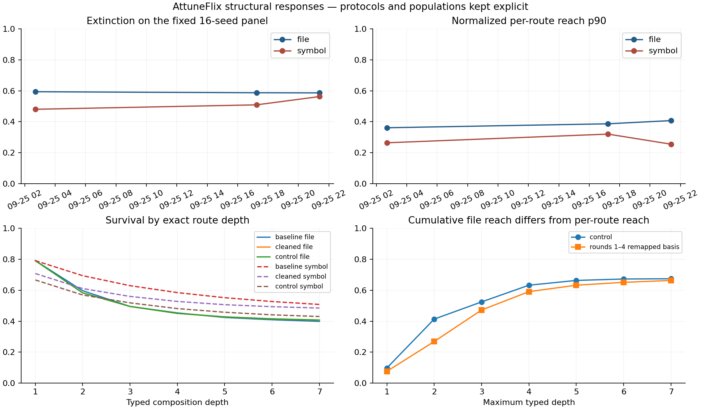
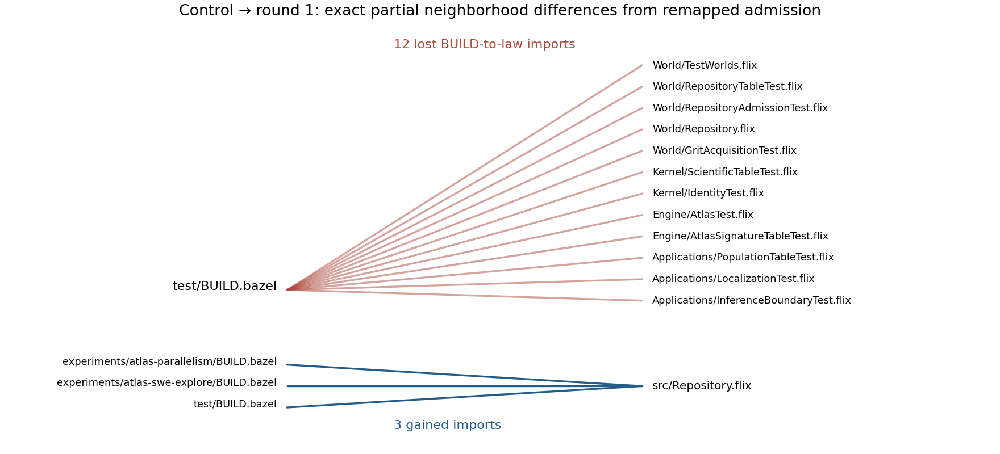
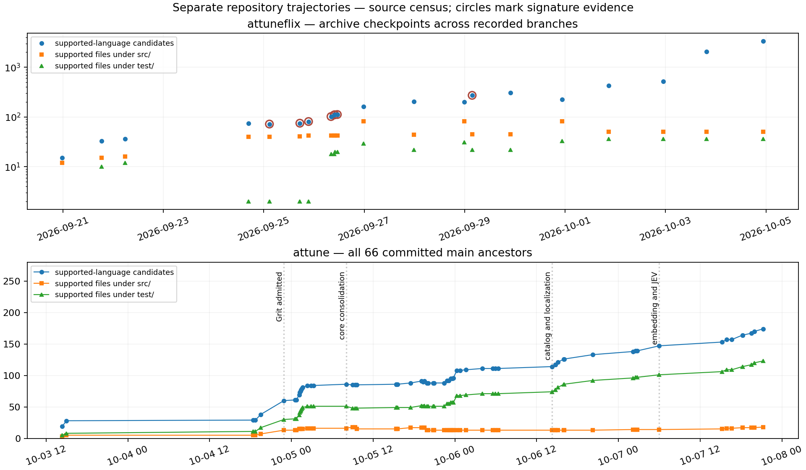

# Attune repository structure through time

AttuneFlix has a recoverable compositional response history, but it is shorter and more conditional than the build history suggests. Four immutable historical worlds now have depth-seven signature measurements; four later architecture candidates have retained measurements over a remapped control basis. The newer Attune has a verified source census through its latest committed revision, but no recovered whole-repository semantic world. Its localization extraction trees analyze external JS/TS projects and cannot fill that gap.

The strongest result is that the instrument detects several different kinds of change: file and symbol responses diverge during consolidation, small admission changes delay cumulative mixing, and seed turnover can imitate a substantial structural change. Conversely, declared caching and ownership changes can leave the fixed-basis signature unchanged. None of these dimensions alone is an architectural quality score.

Execution date: 2026-10-07. Source revision dates below are UTC, independent of extraction, build and replay dates. All four computations used existing typed Atlas machinery. No Grit acquisition, model/provider call, shared-output-base build, deployment, or reference-output modification was performed.

## Measurements and evidence

The bundle contains **209,856 raw route observations**, **12,116 canonical summary rows**, and the published **2,616-seed physical table**. Three historical Grit input pairs contain **16,671 facts** across 228 source-file occurrences. Every source SHA-256 and byte length in those three pairs matches its exact historical revision; every fact passes source-hash, language and range checks. The same file can occur in multiple revisions, so these are occurrences rather than distinct-file counts.

[inventory.json](inventory.json) and [provenance.tsv](provenance.tsv) record 87 checkpoints: 21 AttuneFlix checkpoints and every one of the 66 committed revisions in the newer Attune's main ancestry. Four have recomputed signatures, four have controlled remapping evidence, and **79 have no recovered semantic signature**. Missingness remains null in [temporal-atlas.json](temporal-atlas.json).

| Historical world | Exact revision | Files | Symbols | Imports | Calls | Measurement |
|---|---|---:|---:|---:|---:|---|
| Baseline | `bcfc126db7b7c7f535353ccc8afca44465903571` | 72 | 762 | 90 | 769 | Newly computed signature over frozen Grit facts |
| Cleaned | `ae2f5e68711121f8ecbf9ce94a7926ca7c7833d1` | 75 | 650 | 125 | 693 | Newly computed signature over frozen Grit facts |
| Real Grit control | `eca979f524661cbe400d22b90c7e3c305b32052e` | 81 | 816 | 137 | 893 | Byte-exact replay of retained observations and summaries |
| Published self-world | `88f97599901df1be52ce8cb06f2a701c464cbbbe` | 272 | 2,344 | 693 | 2,967 | Published headline parity through retained evaluator |

The first three worlds share `atlas-signature-work-topology-v1`. The published world uses `atlas-signature-swe-explore-v1`. Both use the same typed composition grammar and SHA-ranked seed protocol, but their populations, source languages and additional reductions differ. They remain separate series. The first two rows are new downstream measurements, not claims that their full depth-seven signatures were published historically. Relation counts for those rows also have independent retained evidence in the historical [parallelism report](../../../attuneflix/experiments/atlas-parallelism/REPORT.md); raw signature domain cardinalities independently recover the file and symbol populations. The older `attuneflix-self-admission-v1` lexical proxy over these same revisions is explicitly incompatible: it uses module/dotted-token extraction and has no real symbol-call acquisition. Its retained source-as-evidence lists are indexed separately and are not pooled with Grit measurements.

The round series contains exact source revisions `52da64241a61d9d1ebee82c8bf0f8773d63092b0`, `10f3a212d0c4d10a6c06a8f1570b0e2dd284c920`, `73b870983147a3cff26052097adea5e979b84271`, and `c236a3aabfa13e5f36162e895d1ca4742f9730c0`. Each re-admits the same 81-file control facts at candidate paths. These are **controlled reconstructions**, not fresh candidate-wide source acquisitions. The tracked candidate populations are 102, 110, 111 and 112 supported-language files; the measured basis remains 81. Their census hashes and retained per-file source tables are supplied separately. Every candidate source-table SHA-256 and byte length was checked against its revision in [historical-source-witnesses.json](historical-source-witnesses.json).

The old frozen reference checkout at `attuneflix/` remains untouched, at `ce2e3f0a363f67217fa6f1f39ffc7b194d4aa3d7`. Historical revision inspection used the separate existing Jujutsu repository `/home/becker/projects/attuneflix`. New history inspection used an isolated Jujutsu clone of the current checkout. The `jj` on the ordinary PATH is a JSON editor; the actual Jujutsu 0.44.0 binary was used explicitly. No Jujutsu initialization or checkout mutation was made in either shared working tree.

For missing old-history coverage, the deterministic policy selects the last **described** recorded commit per UTC day, breaking timestamp ties by full commit ID, and adds every recovered measurement revision. The old Jujutsu history has 367 non-root recorded commits, including branches and rewrites. These daily checkpoints are an archive census, not an assertion that each is the next ancestor of the previous one. [revision-parents.json](revision-parents.json) preserves ancestry. The latest described old revision is `0420805d901fa2fd35ae5d873028b9742b89d301`; the latest newer revision is `140d1b2d1805a1b55c22c7c1953aa36eb866be98`.

## Published parity and the real signature definition

The published [Atlas Live snapshot](https://atlas-live-five.vercel.app/?snapshot=6bae5cbc218b494824fd4dbdd23e62cdad23301dc9243ee7040a32728daef59a&mode=parallelism) was recovered through its [manifest](https://atlas-live-five.vercel.app/manifest.json) and content-addressed asset URLs. Its metadata, entities, relations and physical table hash-match the published manifest and the local immutable basis. All 272 retained materialized source files also SHA-match the exact Jujutsu revision. This verifies the retained source snapshot, while the missing per-fact source-hash acquisition table remains a provenance limitation. The preserved `signature`, `summary`, and `report` Flix tools replayed it. All checked headlines are numerically exact:

| Quantity | Replay |
|---|---:|
| File-seed extinction | 0.499199451052150 |
| Symbol-seed extinction | 0.658356206160415 |
| File-seed normalized reach p90 | 0.191176470588235 |
| Symbol-seed normalized reach p90 | 0.125000000000000 |
| Median seed physical compression | 5.058904773954116 |
| Signature-panel physical reuse fraction | 0.962243247045582 |

[published-parity.json](published-parity.json) also verifies that all 16 panel seeds have exactly the same evaluator counters in the published all-seed table. The control replay reproduces **both Parquet files byte for byte**, not just their aggregate metrics: [control-parity.json](control-parity.json).

The implementation is `src/Atlas.flix`, `src/Atlas/Signature.flix`, `src/Atlas/Signature/{Table,Summary}.flix`, and `Repository.Physical`, with existing experiment adapters. [evaluator-manifest.json](evaluator-manifest.json) hashes the source closure, compiler, JVM dependency jars and retained tool artifacts. [canonical-instrument-source.tar.gz](canonical-instrument-source.tar.gz) preserves the exact source closure of the reconstructed control adapter. No signature algorithm was replaced or approximated.

The fixed grammar has atoms `defines`, `defined_in`, `imports`, `imported_by`, `calls`, `callers`. Each admits only its nominal input domain. Composition is the sole constructor; no union, reverse constructor, learned route selection or beam enters this family. There are three well-typed continuations at each step, giving 3, 9, 27, 81, 243, 729 and 2,187 programs at exact depths 1–7, or **3,279 total programs per seed**.

Eight File and eight Symbol singleton seeds are ranked by unsigned SHA-256 of their declared identities. File identities include paths; Symbol identities include path, name and byte range. A refactor that changes offsets can replace a Symbol seed even if its logical purpose survives. The measured signature is the resulting structural response table. Cryptographic digests identify inputs and exact result sets; they are not the structural signature itself.

Extinction is the fraction of empty route outputs. Survival at depth d uses routes of exactly that depth. Reach divides output cardinality by the **compatible terminal domain** cardinality. A File-seed cohort can contain routes ending in either File or Symbol; its p90 is not a union of file neighborhoods. Expansion divides output cardinality by the immediate prefix input cardinality and is undefined for empty inputs. Canonical quantiles select sorted index `floor((n−1)*percentile/100)`, rather than interpolating.

The work-topology cumulative curve is a different reduction: for each File seed, union all outputs from routes of length at most d, map symbol outputs to declaring files, then divide by admitted file count and average across seeds. D50 is the first depth at which this curve reaches 50%. An unreached threshold is encoded as 8 in the historical oracle. It must not be substituted for per-route p90 reach.

Structural recurrence groups exact semantic-state IDs; the canonical domain summary pools observations across that domain's seeds. Physical work counts transition requests, memo misses/evaluations and reuse hits inside each seed's evaluator. Physical unique-state totals sum per-seed states. These denominators differ, so structural recurrence and evaluator reuse stay separate.

The viewer's 6,332 graph links are 2,344 defines + 693 imports + 2,967 calls + 328 directory parent links. The three inverses are derived by Atlas; parent links are not an Atlas atom. Thus the viewer link count is not the edge denominator of a six-relation composition graph.

## Signature evolution on immutable Grit facts

| Fixed work-topology series | File extinction | Symbol extinction | File-seed reach p90 | Symbol-seed reach p90 | Cumulative file reach at 7 | Physical reuse |
|---|---:|---:|---:|---:|---:|---:|
| Baseline | 59.401% | 48.063% | 0.361111 | 0.263889 | 0.649306 | 97.208% |
| Cleaned | 58.756% | 50.923% | 0.386667 | 0.320000 | 0.656667 | 97.091% |
| Control | 58.657% | 56.267% | 0.407407 | 0.254902 | 0.674383 | 97.270% |

The cleanup removes 112 symbols while adding three files. Imports per file increase **1.25 → 1.666667**; calls per symbol increase **1.009186 → 1.066154** even though raw calls fall **769 → 693**. Source differences remove duplicate build-side Atlas and repository surfaces and share seed-panel implementation. The relation-density increase is consistent with concentrating edges onto a smaller symbol population. It does not establish that consolidation reduced module coupling. Independent historical depth-two measurements also report cross-region import fraction **0.867 → 0.888**, median file blast **18 → 28**, and shared hotspots **14 → 16**. This is evidence that a smaller source surface can remain, or become, more coupled under this vocabulary. [source-cleanup.diff.txt](source-cleanup.diff.txt) retains the inspected source changes.

File extinction falls 0.644 percentage points while Symbol extinction rises 2.859 points. Both normalized p90 reaches increase. D50 stays at 3. The response does not collapse to a single favorable/unfavorable direction. A navigation hypothesis is that a smaller symbol surface with denser retained connections exposes fewer declarations but broader neighborhoods; no observed navigation tasks establish whether that tradeoff helped an agent.

The cleaned-to-control interval adds six files and 166 symbols. File extinction barely changes, but Symbol extinction rises **50.923% → 56.267%**, a seemingly strong discontinuity. The fixed panel retains all eight File seeds but only five Symbol seeds. On those five shared Symbol identities, extinction is **49.826167% → 49.820067%**, essentially unchanged and slightly lower. The panel-level jump is therefore primarily a sampling/identity-turnover signal, not convincing evidence of increased extinction among continuing symbols. This is a diagnostic comparison, not a counterfactual full-domain measurement. [matched-seed-comparisons.json](matched-seed-comparisons.json) preserves exact identities, denominators and values.

The largest absolute extinction move among adjacent measured worlds is the Symbol change above. The largest p90-reach move is also Symbol, **0.320000 → 0.254902**. Selecting change points dimension by dimension exposes that sampling issue; summing the dimensions into a quality score would hide it. The source interval introduces maintained Grit frontend files and the acquisition machinery: [source-grit-acquisition.diff.txt](source-grit-acquisition.diff.txt). Acquisition timestamps alone cannot assign these changes to source revisions; the frozen source hashes supply that binding.

## The remapping transition and a negative case

At control → round 1 (`eca979f5… → 52da6424…`), cumulative depth-two file reach falls **0.413580 → 0.268519**, D50 moves **3 → 4**, yet depth-seven reach changes only **0.674383 → 0.663580**. The retained oracle locates the cause: **12 lost BUILD-to-law import edges and three gained BUILD-to-Repository edges** after file moves. Defines and calls remain at 816 and 893; admitted imports change **137 → 128**. It is conservative re-admission of frozen Starlark label/glob facts at changed paths, rather than a loss of Flix call semantics or a fresh whole-candidate extraction.

[neighborhood-comparison.json](neighborhood-comparison.json) gives each source/target pair. It is an exact partial neighborhood witness, not a reconstructed complete graph. The 15-edge symmetric difference affects just 15/137 original forward import edges, but its location around build/law boundaries produces a much larger shallow response than deep response. The D50 displacement uses the historical experiment's full one-depth preservation allowance.

The four round curves are identical. Nevertheless, control-to-round-3 ownership cut falls **35/53 = 0.660377 → 36/65 = 0.553846**, cross-region fraction falls **121/137 = 0.883212 → 108/137 = 0.788321**, shared hotspots fall **17 → 15**, and the maximum region blast falls **199 → 139.5**. Note the ownership-cut denominator changes; the numerator actually rises by one. These ownership quantities concern grouping a frozen basis and cannot prove that the whole repository became more local. The primary eight-way work cut only changes **96/137 → 95/137**. The original report calls the outcome inconclusive/trade-off, which remains the appropriate interpretation.

**Negative case:** round 3 → round 4 (`73b87098… → c236a3aa…`) introduces declared, cacheable artifact boundaries for expensive stages. The inspected build-rule changes are retained in [source-cache-boundaries.diff.txt](source-cache-boundaries.diff.txt). The cumulative signature curve, D50 and retained remapped basis counts do not appreciably change: the curves are exactly equal. This is a meaningful execution/build organization change outside what this fixed semantic basis can sense. Equal curves do not establish that the complete route tables or complete candidate graphs are identical; those were not retained for every round.

## Language coverage and the architectural transition

The baseline, cleaned and control worlds contain only Flix, Java and Starlark. Their language counts are **41/11/20**, **42/11/22**, and **48/11/22**. There is no unsupported-language file in those inclusion tables, but semantic extraction remains partial. The control has **507 unresolved imports and 2,967 unresolved calls**, alongside 137 and 893 admitted edges. These refusal counters must accompany its graph. The published world has **1,241 unresolved imports and 12,100 unresolved calls**, alongside 693 and 2,967 admitted edges. These are resolver counters, not calibrated percentages of every possible dependency.

The published world includes **109 Flix, 12 Java, 47 Starlark, 92 TypeScript and 12 JavaScript files**. Its common supported Flix/Java/Starlark population is 168 files; the full available population is 272. [signature-points.json](signature-points.json) supplies both population views. A common-language **signature** for the published world was not produced: its raw Grit source/fact table was not recovered, and filtering its present graph would silently change admission/resolution and identities. The full published snapshot remains a valid parity anchor, not a clean extension of the three-language time series.

The newer Attune frontend retains real Flix, Java and Starlark queries and grammar pins. The Grit seam fixtures exercise actual calls across eight supported surfaces and actual Flix/Java/Starlark import resolution; the retained Grit test receipt reports zero failures. This demonstrates frontend capability on fixtures, not whole-repository completeness. Its pinned Grit revision is `c80b3026471b229f41b279c3eb0c162dcdacfdb1`, Flix grammar `78cff149b2e9897456f94844872353b5ee0ca93b`, and Starlark grammar `a453dbf3ba433db0e5ec621a38a7e59d72e4dc69`.

Crucially, current `LocalizationStages.worldExtract` calls `Study.isSourcePath`, whose declared extensions are **js, jsx, mjs, cjs, ts, tsx, mts, cts**. A cached localization tree is therefore not a polyglot self-extraction route. The current panel declares 92 external worlds; 90 cached extraction receipts were found. All 90, the 136 non-self old metadata records, and six final-topology specimen worlds are explicitly excluded in [excluded-artifacts.json](excluded-artifacts.json). Cached modern world receipts omit source-content hashes; current manifest associations are useful inventory context, not proof that a cached artifact came from that exact manifest generation.

The new repository's latest supported-source census has **174 candidate files: 95 Flix, 14 Java, 54 Starlark and 11 Ruby fixtures**. Its common-language candidate slice contains 163 files, but **zero of those files has a recovered self-world measurement**. The 174 is a source count, not a graph population. Unsupported source families such as Grit query text, Rust support and editor assets do not become graph-isolated nodes. Common semantic coverage across the architectural transition is unknown, so the cross-project signature comparison is non-equivalent and remains uncomputed.

Source evidence still establishes meaningful architectural events. At `7a32afb5… → d901935b…`, the source population changes **86 → 85**, while production-supported files change **16 → 18**: typed world identity and Fact values, Apply and Study owners replace proposal-layer semantics. At `b28fc778… → eab5dbbb…`, total candidates stay **85**, while production-supported paths change **18 → 15** as Grit moves under Repository and native mechanics move under `platform/tools`. File placement changes substantially despite unchanged total size. The Theory promotion at `b21b97bf… → 83764734…` adds an explicit production owner; the later `438d73d0… → 66e98a16…` moves stage algorithms into Study and Theory with **108 candidates unchanged**. Their source diffs are retained. These events cannot currently substantiate a reduction in compositional mixing.

The final source distribution is 18 supported files under `src/`, 123 under `test/`, and 33 elsewhere. These are path strata, not cognitive/mechanical classifications; generated versus authored ownership cannot be inferred reliably from the paths alone. Similarly, old-history supported candidates grow **514 → 2,053 → 3,318** in late research revisions while `src/` candidates remain **50** and `test/` candidates remain **36**. The growth is outside those roots, including retained research/architecture specimens. Treating all those files as growth of the meaning-bearing kernel would be misleading. The source census reports physical lines and bytes, never parser-exact code LOC.

## Physical execution and structural hubs

| Fixed fact replay | Requests | Evaluations | Reuses | Routes divided by evaluations |
|---|---:|---:|---:|---:|
| Baseline | 341,184 | 9,525 | 331,659 | 5.508031 |
| Cleaned | 341,184 | 9,924 | 331,260 | 5.286578 |
| Control | 341,184 | 9,315 | 331,869 | 5.632206 |
| Published panel, separate series | 341,184 | 12,882 | 328,302 | 4.072660 |

These are exact evaluator counters. The published headline **5.058905** is the median of per-seed compression, whereas **4.072660** is pooled routes/evaluations. Reporting one as a failed replay of the other would be a denominator error. Old control summaries retain domain totals but not individual seed physical counters, so their median seed compression remains unavailable.

The published all-seed table has **55,783,584 requests, 2,085,708 evaluations and 53,697,876 reuses**, giving **96.261072%** reuse. The 16-seed panel gives **96.224325%**. Both are correct for their own populations. No cold/warm extraction or signature cost was newly measured. BuildBuddy invocation duration and action-cache hits remain build metadata; they do not become evaluator reuse or architectural locality evidence.

Published per-path cohorts differ substantially: `src/` median compression is **5.663212**, `web/` **3.835088**, `experiments/` **3.903571**, `test/` **7.286667**, and `build/` **9.146604**. [physical-path-cohorts.json](physical-path-cohorts.json) preserves seed counts and pooled reuse. Small or terminating states can be highly reusable; these values do not show that mechanical code is structurally superior. A reliable authored/mechanical attribution requires a source ownership census joined to these exact seed identities.

Actual published import hubs include `src/ScientificTable.flix` (46 incoming imports), viewer `graph.ts` (34), `src/Repository/Structure.flix` (31), and `ScientificTable/Columns.flix` (28). There are both shared scientific-interface hubs and a substantial presentation hub. [published-import-hubs.json](published-import-hubs.json) retains the measured rows. There is insufficient earlier whole-world edge evidence to establish when each became a hub or whether the newer kernel isolated itself from them.

Directional, depth and typed-route-family differences remain available in the canonical summary Parquet. Repeated exact states and same-as-input fractions are measured. Learned family membership, full candidate neighborhood splits, and local-versus-global authored-core regularity are unavailable for this self population; external Atlas Families outputs cannot replace them.

## BuildBuddy recovery and replay

BuildBuddy History returned ten invocations for the SWE signature tool, one successful final-topology `source_signatures` invocation, four control-signature invocations, two self acquisition invocations, three parallelism acquisition invocations, and ten control acquisition invocations. These exact-pattern searches exhausted their returned pages. All inspected history records omit commit SHA. The self acquisition log binds invocation `f7446c91-9f80-4c49-b189-079e6787d6b5` to the published source revision and counts; other acquisition invocation IDs are retained as candidates rather than assigned by timestamp.

The successful final-topology invocation `c6513144-0d03-400d-97ae-cde433c05d29` exposes content-addressed outputs, but their identities are `attune-final-topology/A`, `/B`, `/C`, not Attune's whole source tree. One requested CAS blob returned **Exhausted all peers**. Local immutable specimen artifacts survive, and remain excluded. A cache hit never supplies missing source identity.

The inventory is bounded to the named target families, retained repository metadata, known source/fact pairs and visible extraction trees. It is not a claim that every artifact in the entire BuildBuddy CAS or every rewritten historical evidence version has been exhaustively searched. An unidentified 213-file temporary Grit acquisition pair is retained as an inventory lead, not included as a historical world. Its missing revision receipt is a real gap.

[REPLAY.md](REPLAY.md) gives minimal downstream commands. The successful runs reused retained JVM tools, compiled the existing control adapter once in `/tmp/attune-longitudinal`, then consumed immutable facts. The shared Bazel server and Factory Droid were present; their output base was never invoked. There was no coordinated new polyglot extraction window and no ready self-extraction target in the newer tree. New Grit work was therefore not launched. A bounded follow-up can cover the 66-revision new-history gap initially with predeclared bootstrap, post-Grit, post-consolidation and latest checkpoints, using the same pinned stack and coverage contract.

[temporal-atlas.json](temporal-atlas.json) is a versioned sidecar for a future time scrubber. It embeds the published Atlas Live world entry verbatim, refers to hashed measurement assets, preserves separate repository trajectories and protocols, and represents absent worlds as absent measurements. [atlas-live-worlds.json](atlas-live-worlds.json) also provides the existing viewer's version-1 manifest shape, with the verified self-world's locations, physical and anchor assets retained locally and paths adjusted to this bundle. The existing viewer has no temporal consumer; no interface was deployed or overwritten. The figures provide the standalone visualization now.

## Assessment as a development instrument

The signature is useful as a **response-change instrument** when it is accompanied by source/fact identity, coverage, seed survival and independent source differences. The cleanup comparison detects denser retained relations despite fewer symbols. The remapping comparison detects shallow mixing sensitivity that a depth-seven endpoint largely hides. The matched-seed comparison diagnoses a false-looking change point. The negative caching case establishes a substantive blind spot.

This execution does not demonstrate prediction. The historic protocol predates the work-topology refactoring, and its D50 allowance functioned as an existing stopping condition. The baseline/cleaned full-depth measurements here are retrospective. No held-out sequence shows that their values signaled architecture before a developer noticed it. Identical round curves concern retained controlled evidence, not a discovered universal equivalence between unrelated full repositories.

For continuous use, persist a polyglot self-world at each accepted source identity, version query/resolver/admission semantics, retain refused sources and unresolved relations, and keep both a fresh hash-ranked panel and a matched logical-seed diagnostic. Report directory and authored/mechanical strata beside full available and common-coverage graphs. Freeze alert thresholds before subsequent changes; assess alerts against independent source review and observed navigation/decomposition tasks. Preserve physical counters separately, and measure cold/warm cost only through explicitly bound executions. Use a prospective control sequence of routine tests, semantic fixes and structural reorganizations rather than training the signal to recognize the events already in this report.

## Five most surprising structural observations

1. **A cleanup can grow the file population while shrinking the symbol population.** `bcfc126d… → ae2f5e68…` changes 72/762 files/symbols to 75/650; imports per file rise 1.25 → 1.666667 and calls per symbol rise 1.009186 → 1.066154. Fewer symbols did not mean lower retained coupling.
2. **File and Symbol responses can move in opposite directions in the same revision pair.** The same cleanup lowers File extinction 59.401% → 58.756% while raising Symbol extinction 48.063% → 50.923%; both p90 normalized reaches increase. One scalar would erase the distinction.
3. **A prominent Symbol change point nearly vanishes when continuing seeds are compared.** `ae2f5e68… → eca979f5…` raises panel extinction 50.923% → 56.267%, but the five common Symbol seeds move 49.826167% → 49.820067%. Byte-range-based seed identity is a material longitudinal confounder.
4. **Fifteen admission-edge changes can delay shallow mixing much more than they alter deep reach.** `eca979f5… → 52da6424…` loses 12 and gains three build/law imports; depth-two cumulative reach falls 0.413580 → 0.268519, D50 moves 3 → 4, but depth-seven reach falls only 0.674383 → 0.663580.
5. **A meaningful execution reorganization can be signature-silent.** `73b87098… → c236a3aa…` adds declared cacheable stage boundaries while its retained cumulative signature curve and D50 remain exactly unchanged. The instrument senses the admitted semantic basis; it misses important work-organization changes outside that basis.
