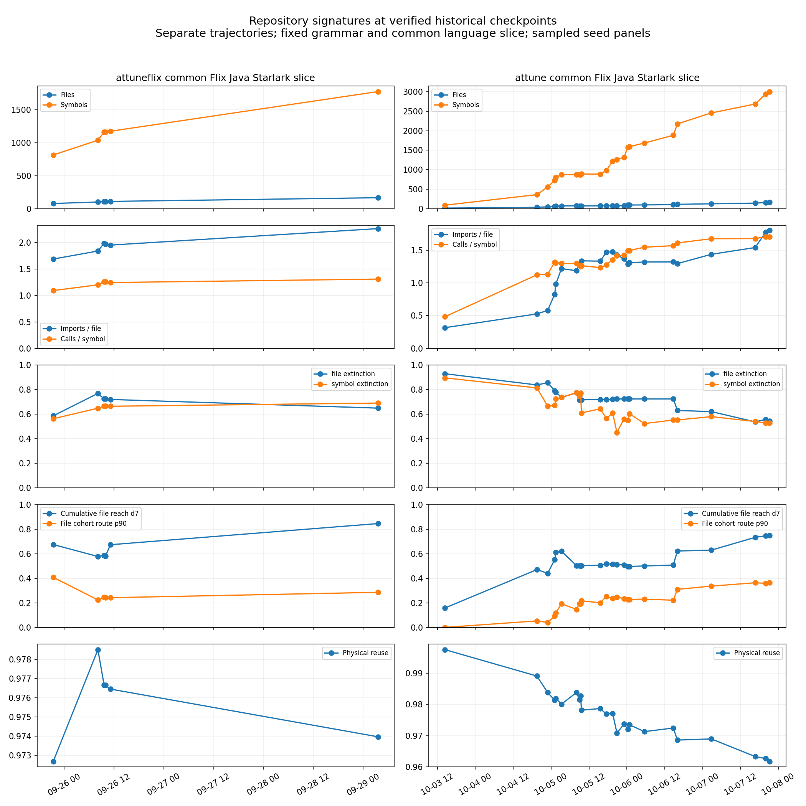
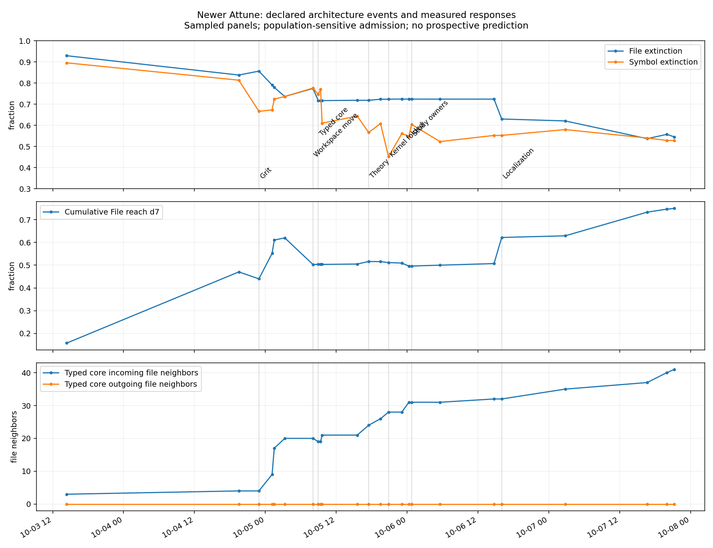
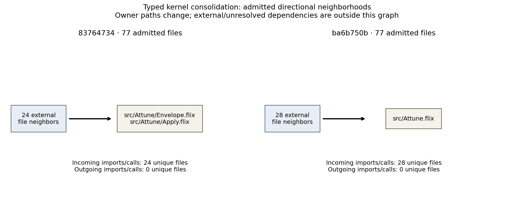

# Attune signatures at higher resolution

The frozen batch produced **30 measured checkpoints**: 24 newer Attune snapshots and 6 AttuneFlix snapshots. Every eligible point has a real Grit fact basis, canonical admission, 16 SHA-ranked seeds and depth-one through depth-seven typed Atlas responses. The raw tables contain **1,573,920 route observations**. This closes the newer repository coverage gap for the selected checkpoints; it does not fill the unselected history.

## Measurement and provenance

The policy was frozen before measurement: every fourth newer chronological ancestor, the endpoints, and the declared before/after architecture pairs. The six older points are the retained control, four architecture candidates and the published revision measured on the common language slice. [The selection and exact source manifests](plan.json) contain all 30 points and the original 36-checkpoint / 6,000-source-instance / 2,500-unique-input limits. The selected common-language population totals 2,788 source instances. The protocol is `atlas-signature-checkpoint-common-v1`; the Atlas grammar remains `atlas-composition-depth7-v1`.

Both repository trajectories use Flix, Java and Starlark, the same byte-pinned frontends, the existing canonical admission and the original Atlas evaluator. They remain separate trajectories: Attune is a rewrite, not the next revision of AttuneFlix. Source paths are normalized to each project root, so moving the newer project into its `attune/` child does not manufacture a new path prefix for every semantic file. Actual file moves within that root remain visible.

All nine active frontend files byte-match the recovered control and published-revision query inventories. Earlier baseline/cleaned query bodies are unavailable. Only control facts from the older retained tables were actually reused; no baseline/cleaned rows enter this batch. Exact `(path, source SHA-256, language)` facts are reused from the verified control tables and earlier acquisitions in this batch. Changed paths or bytes receive real Grit acquisition. The control therefore needs no Grit rerun. Each source was separately materialized with `jj file show` at its precise revision and SHA-256 checked; each fact was checked against source language, hash and byte range. The control replay matches all **52,464 original route response rows** after the explicit metadata-version changes; its source and fact rows are exact. See [parity](control-parity.json), [provenance](provenance.tsv), [inventory](inventory.json), [stack pins](stack.json) and [evaluator identity](evaluator-manifest.json).

No shared Bazel output base, provider/model route, published viewer, reference checkout or existing research fixture was changed. The computations use the cached native shared library and isolated historical Flix instrument closure. The adapter changes repository/source/acquisition metadata and dispatch only; the Atlas source, composition grammar, seed admission and canonical reductions are unchanged.

## Checkpoint measurements

| Repository | Revision | Files | Symbols | Imports | Calls | File extinction | Symbol extinction | Cumulative file reach d7 | Physical reuse |
|---|---|---:|---:|---:|---:|---:|---:|---:|---:|
| attuneflix | `eca979f5` | 81 | 816 | 137 | 893 | 58.66% | 56.27% | 67.44% | 97.27% |
| attuneflix | `52da6424` | 102 | 1039 | 188 | 1250 | 76.88% | 64.85% | 57.72% | 97.85% |
| attuneflix | `10f3a212` | 110 | 1162 | 219 | 1462 | 72.38% | 66.47% | 58.52% | 97.67% |
| attuneflix | `73b87098` | 111 | 1162 | 219 | 1462 | 72.38% | 66.47% | 58.00% | 97.67% |
| attuneflix | `c236a3aa` | 112 | 1175 | 219 | 1464 | 71.98% | 66.43% | 67.30% | 97.65% |
| attuneflix | `88f97599` | 168 | 1776 | 381 | 2329 | 64.91% | 69.03% | 84.52% | 97.40% |
| attune | `fb13fb76` | 19 | 93 | 6 | 45 | 92.91% | 89.54% | 15.79% | 99.76% |
| attune | `71101348` | 38 | 363 | 20 | 408 | 83.78% | 81.35% | 47.04% | 98.91% |
| attune | `06e6fc33` | 50 | 560 | 29 | 634 | 85.62% | 66.64% | 44.00% | 98.38% |
| attune | `6995e36c` | 58 | 728 | 48 | 961 | 79.06% | 67.30% | 55.17% | 98.14% |
| attune | `d64da42b` | 68 | 806 | 67 | 1052 | 77.93% | 72.38% | 61.03% | 98.18% |
| attune | `dd2c93de` | 73 | 876 | 89 | 1137 | 73.64% | 73.64% | 61.99% | 98.01% |
| attune | `7a32afb5` | 75 | 878 | 89 | 1139 | 77.42% | 77.63% | 50.33% | 98.38% |
| attune | `d901935b` | 74 | 880 | 95 | 1117 | 71.70% | 74.62% | 50.34% | 98.16% |
| attune | `b28fc778` | 74 | 879 | 95 | 1102 | 71.70% | 77.15% | 50.34% | 98.27% |
| attune | `eab5dbbb` | 74 | 891 | 99 | 1126 | 71.70% | 61.03% | 50.34% | 97.82% |
| attune | `b21b97bf` | 75 | 889 | 100 | 1097 | 71.85% | 64.36% | 50.50% | 97.87% |
| attune | `83764734` | 77 | 988 | 113 | 1261 | 71.84% | 56.63% | 51.62% | 97.69% |
| attune | `6db53dfc` | 80 | 1217 | 118 | 1650 | 72.35% | 60.85% | 51.56% | 97.71% |
| attune | `ba6b750b` | 77 | 1262 | 110 | 1786 | 72.37% | 45.15% | 51.14% | 97.08% |
| attune | `c7e5de3b` | 81 | 1318 | 111 | 1878 | 72.44% | 56.10% | 50.93% | 97.37% |
| attune | `438d73d0` | 97 | 1578 | 125 | 2356 | 72.40% | 54.88% | 49.61% | 97.20% |
| attune | `66e98a16` | 97 | 1593 | 127 | 2383 | 72.40% | 60.45% | 49.61% | 97.35% |
| attune | `7fe69f31` | 100 | 1685 | 132 | 2605 | 72.40% | 52.33% | 50.00% | 97.13% |
| attune | `954158b2` | 106 | 1884 | 140 | 2957 | 72.40% | 55.23% | 50.71% | 97.24% |
| attune | `8fd3ba08` | 115 | 2177 | 149 | 3508 | 63.00% | 55.25% | 62.17% | 96.86% |
| attune | `480b5349` | 128 | 2456 | 184 | 4116 | 62.09% | 58.00% | 62.89% | 96.89% |
| attune | `3d1ad901` | 146 | 2685 | 225 | 4506 | 53.71% | 54.01% | 73.29% | 96.33% |
| attune | `c6b5bd7b` | 159 | 2939 | 282 | 5013 | 55.73% | 52.87% | 74.61% | 96.26% |
| attune | `140d1b2d` | 163 | 2998 | 294 | 5112 | 54.55% | 52.87% | 74.92% | 96.18% |

The signature reports compatible-terminal-domain route reach, extinction/survival, expansion and pooled structural recurrence. Cumulative file reach is the separate canonical work-topology union of route responses projected to files. Physical reuse is measured by per-seed memo counters; it is not structural recurrence or a locality score. Physical compression here is pooled logical routes per physical evaluation, not the published viewer’s median seed compression. Native summary rows, depth curves, final-atom families, normalized densities and extraction populations are retained in [the dataset](signature-points.json) and [canonical summary Parquet](signature-summary-rows.parquet).

## Structural changes

**Workspace relocation mostly changes the sample.** `dd2c93de → 7a32afb5` changes 73→75 files, 876→878 symbols, 89→89 imports and 1,137→1,139 calls. Whole-panel File extinction moves 73.64%→77.42% and cumulative reach 61.99%→50.33%. But all 5 shared File seeds and 5 shared Symbol seeds have identical extinction. Their route output counts match in 31,541 of 32,790 paired route rows. [The source diff](diffs/dd2c93de-7a32afb5.diff) moves mechanical boundary/build files and adds a few definitions. SHA-ranked panel turnover can create a large apparent structural change from a small graph change.

**Typed-core consolidation changes route survival without widening global reach.** `7a32afb5 → d901935b` changes 75→74 files, 878→880 symbols, 89→95 imports and 1,139→1,117 calls. File extinction drops 77.42%→71.70%, while cumulative file reach remains 50.33%→50.34%. [The diff](diffs/7a32afb5-d901935b.diff) introduces the single typed Apply evaluator and memo, structured identity, artifact values and Study contracts while replacing proposal-owned semantics. These are different signature dimensions: more surviving compositions need not imply larger reachable neighborhoods. For the seven shared File seeds, extinction falls only 76.60%→75.12%; the four shared Symbol seeds change 76.014%→75.938%. The full-panel change therefore mixes altered responses with sampling turnover. [changes.json](changes.json) retains both reductions.

**Removing policy scaffolding is a negative case for aggregate alerts.** `d901935b → b28fc778` removes 15 admitted calls and one symbol while retaining 74 files and 95 imports. File extinction and the complete cumulative file reach curve are unchanged. [The diff](diffs/d901935b-b28fc778.diff) removes duplicated policy report/audit traversal scaffolding. The sampled File response dimensions miss that meaningful simplification; this is not a claim that every Symbol or physical dimension is identical.

**Theory produces a large panel change that matched Symbol seeds do not reproduce.** `b21b97bf → 83764734` adds 99 symbols, 13 imports and 164 calls across two additional files. File extinction changes -0.011 percentage points; Symbol extinction changes -7.731 points. Cumulative file reach changes +1.123 points. [The diff](diffs/b21b97bf-83764734.diff) promotes the bounded native theory, consolidates the coverage vocabulary and adjusts its callers. The two shared Symbol seeds have exactly unchanged extinction; the eight shared File seeds retain the small File change. The full Symbol panel is largely a sampling response here, so its large shift cannot establish that the architectural change was detected. This retrospective result does not establish prospective prediction.

**Study ownership changes without source-population growth.** `438d73d0 → 66e98a16` keeps 97 files, adds 15 symbols, 2 imports and 27 calls. Its File and Symbol extinction changes are +0.000 and +5.562 percentage points. [The diff](diffs/438d73d0-66e98a16.diff) moves algorithms from stage fixtures into Study/Theory owners and adds bounded-manifest refusal. The seven shared Symbol seeds change extinction only 56.454%→56.433%; most of the full-panel shift is sampling turnover. Source count alone cannot identify this architectural change.

**The older real snapshots differ from the frozen remapping experiment.** The previous report’s identical round-1 through round-4 oracle curves concern a re-admitted 81-file control basis. These new points extract the actual candidate source trees: 102, 110, 111 and 112 files. At real `73b87098 → c236a3aa`, symbols change 1162→1175, calls 1462→1464, File extinction 72.38%→71.98% and cumulative reach 58.00%→67.30%. [The source changes](diffs/73b87098-c236a3aa.diff) add the artifact/cache measurement surfaces. A preserved control signature does not establish a preserved whole-repository signature.

## Kernel boundaries and coverage

At `7a32afb5`, the declared typed core is `src/Attune/Envelope.flix`. It has 20 incoming external file neighbors and 0 outgoing external file neighbors over admitted imports/calls. The exact per-relation edges are retained in each point. Internal edges between Envelope and Apply are excluded from this boundary count.
At `d901935b`, the declared typed core is `src/Attune/Envelope.flix`, `src/Attune/Apply.flix`. It has 19 incoming external file neighbors and 0 outgoing external file neighbors over admitted imports/calls. The exact per-relation edges are retained in each point. Internal edges between Envelope and Apply are excluded from this boundary count.
At `83764734`, the declared typed core is `src/Attune/Envelope.flix`, `src/Attune/Apply.flix`. It has 24 incoming external file neighbors and 0 outgoing external file neighbors over admitted imports/calls. The exact per-relation edges are retained in each point. Internal edges between Envelope and Apply are excluded from this boundary count.
At `ba6b750b`, the declared typed core is `src/Attune.flix`. It has 28 incoming external file neighbors and 0 outgoing external file neighbors over admitted imports/calls. The exact per-relation edges are retained in each point. Internal edges between Envelope and Apply are excluded from this boundary count.
At `140d1b2d`, the declared typed core is `src/Attune.flix`. It has 41 incoming external file neighbors and 0 outgoing external file neighbors over admitted imports/calls. The exact per-relation edges are retained in each point. Internal edges between Envelope and Apply are excluded from this boundary count.

The core owner changes path when Envelope/Apply are folded into `src/Attune.flix`; the dataset follows those actual owners. Inbound dependence can make a compact typed core a structural hub. Outbound independence is a different property. These measurements concern admitted repository-internal relations: external standard-library and native dependencies are outside the world. Claims about navigation or agent decomposition remain hypotheses, with no observed navigation-task evidence in this batch.

The latest selected newer revision, `140d1b2d`, has 163 files and 2998 symbols in this slice. Its source populations are {'notes': 1, 'platform': 30, 'root': 2, 'src': 18, 'test': 112}; symbol populations are {'notes': 1, 'platform': 222, 'root': 24, 'src': 1006, 'test': 1745}. It retains 703 unresolved imports and 10078 unresolved calls. [Per-language facts and zero-fact source lists](signature-points.json) distinguish files with emitted facts from files merely admitted by a supported extension.

Ruby fixtures are explicitly outside the three-language series; JS/TS is outside the newer common slice and excluded from the older published snapshot’s common-language point. Nix/Rust/C and inherited editor grammar sources are outside the declared candidate-source vocabulary. No unsupported file is introduced as an isolated graph node. Fixed frontends deliberately omit Flix type aliases and instance declarations. Static relation extraction does not encode type-checking guarantees, dataflow, exact function behavior, provider/API semantics or observed navigation difficulty. Successful fixed-query execution is not proof of exhaustive parsing or dependency completeness.

The old published 272-file headline and its new common-language snapshot are different populations and different protocol labels; their difference cannot be called architectural simplification. More seriously, admission itself changes with the population. At the identical published revision, the full world contains 2,280 calls wholly inside the common slice; genuine reacquisition and admission of that slice produces 2,329, gaining 49 calls and losing none. All 1,776 shared symbol definitions and 381 imports match. Every gained call has a target name that was ambiguous in the full population and becomes unique in the smaller world. Canonical `Repository.target()` first resolves a unique same-file name, then a globally unique simple name, without a language boundary. The retained witnesses include Starlark builtin `fail(...)` incorrectly linked to a Flix test helper. This is an admission artifact, not new architecture, and constrains cross-language coupling claims. See [relation audit](published-common-relations-audit.json), [definition audit](published-common-definition-audit.json) and [all 49 witnesses](published-common-gained-call-witnesses.json). The frozen resolver is preserved for protocol consistency; a future corrected resolver requires a new protocol series. The earlier full-available published world remains in the immutable parent bundle, with its original parity result. All source and evaluator identities remain explicit.

## Execution history and replay

Successful local `acquire` stages: 20 receipts, median 31.71 seconds, maximum 177.25 seconds, accumulated 879.24 seconds. The acquisition receipts include preserved early stages; signature receipts also include initial downstream metadata-adapter checks. These are direct elapsed measurements, not clean cold/warm experiments.
Successful local `acquire_program` stages: 630 receipts, median 0.71 seconds, maximum 117.30 seconds, accumulated 792.90 seconds. The acquisition receipts include preserved early stages; signature receipts also include initial downstream metadata-adapter checks. These are direct elapsed measurements, not clean cold/warm experiments.
Successful local `world` stages: 33 receipts, median 1.26 seconds, maximum 4.49 seconds, accumulated 47.18 seconds. The acquisition receipts include preserved early stages; signature receipts also include initial downstream metadata-adapter checks. These are direct elapsed measurements, not clean cold/warm experiments.
Successful local `signature` stages: 33 receipts, median 11.83 seconds, maximum 19.27 seconds, accumulated 402.72 seconds. The acquisition receipts include preserved early stages; signature receipts also include initial downstream metadata-adapter checks. These are direct elapsed measurements, not clean cold/warm experiments.

The retained [BuildBuddy history](grit-execution-history.json) includes acquisition-target build times of about 23–89 seconds and signature invocations of about 6–27 seconds. The sampled acquisition logs end at successful launcher builds; their subsecond warm durations do not measure source-tree Grit execution. [Detailed logs](buildbuddy-timing-detail.json) preserve that distinction. Direct current stage receipts are the useful basis for this batch’s execution estimate.

After two eight-file acquisition batches hit the 180-second cap, remaining acquisition was split into individual file/program stages, each still capped at 180 seconds. Every successful program table is frozen before the next starts. A native-producer transport failure on genuine zero-fact results was repaired by an explicit empty-result marker and serialization using the existing typed Arrow schema. The marker is emitted only after actual Grit execution; an unsupported or failed source is never replaced by an empty graph. [Producer identities](producer-evaluator-manifest.json) and [transport diff](producer-adapter.diff.txt) distinguish the two producer versions from the unchanged signature evaluator. Representative failure logs are retained; execution receipts retain every failed stage, but temporary logs overwritten during repair are not claimed to be an immutable record of every initial error. Intermediate batch failures are retained in the execution history; eligible final worlds require all three programs for every admitted source. Completed facts and measurements are retained across continuation. The selection never expands into a full-history extraction. [Replay instructions](REPLAY.md) use the cached canonical evaluator over immutable facts and require no upstream Grit. [The temporal sidecar](temporal-atlas.json) supplies per-revision graph assets, canonical directory locations and metrics for a future slider; it is a new temporal schema, not a claim of direct acceptance by the current viewer. It is not a deployed viewer change.

The original 87-checkpoint inventory now has measurements on 32 distinct historical revisions across both bundles: eight older and 24 newer revisions. Thirteen old checkpoints and 42 newer revisions remain without full self-world measurements. They are gaps, not interpolated values. Source census information for the remaining revisions stays available in the parent bundle.

## What this makes useful

The signature can monitor changes in the admitted relation structure and distinguish different responses to population growth, owner movement and graph expansion. It cannot identify intent or correctness, and a small fixed panel is sensitive to seed turnover. A continuous instrument should report an independently resampled panel together with persistent paired seeds, explicit source coverage and direction-specific owner boundaries. Prospective alerts should be declared before examining later source events and checked against independent architecture/task evidence. This batch is retrospective; none of its correlations establishes predictive value.

## Five surprising structural observations

1. **A mostly mechanical workspace move looks like a signature jump.** `dd2c93de → 7a32afb5` changes only two symbols and two calls, yet whole-panel cumulative reach falls 61.99%→50.33%. Shared File/Symbol seeds retain exactly the same extinction.

2. **More surviving routes need not mean broader reach.** `7a32afb5 → d901935b` lowers File extinction 77.42%→71.70%, while cumulative reach remains near 50.33%.

3. **Removing duplicated scaffolding can leave a measured curve exactly unchanged.** `d901935b → b28fc778` loses 15 calls, but File extinction and every cumulative reach depth stay fixed.

4. **Theory’s large Symbol-panel shift does not survive seed matching.** `b21b97bf → 83764734` changes Symbol extinction by -7.731 percentage points versus -0.011 for File extinction. The two shared Symbol seeds have identical extinction, making the attribution to architecture unsupported for that panel dimension.

5. **Removing other languages creates 49 new admitted calls without changing source.** At published revision `88f97599`, the 272-file full world has 2,280 calls wholly within the common slice; the 168-file common world has 2,329. All shared definitions and imports match. Global simple-name admission creates false cross-language links, including Starlark `fail` calls targeting a Flix test helper.
