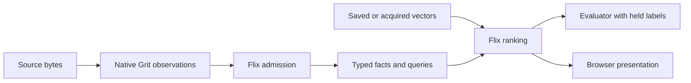

The same repository calculation can consume a saved answer, a shared website artifact, or a declared scientific output. These are distinct execution paths around Flix-owned semantics.

| Owner | What belongs there |
| --- | --- |
| Flix | Identities, effects, admission, agent policy, relations, joins, ranking, failures, metrics. |
| Native/Java boundary | Memory ownership, pinned compiler bootstrapping, declared paths, process isolation, narrow browser ABI. |
| Bazel and BuildBuddy | Dependency identity, declared actions, remote workers and action reuse. |
| Next.js | Trusted public acquisition, shared cached artifacts, bounded provider transport. |
| Browser | Flix computation, transient session state, source/graph presentation. |

The library is independently buildable inside `attune/`; the root graph also builds `web/`. TeaVM exports actual Flix classes through the browser boundary. TypeScript does not substitute a second ranking implementation.

The [build chapter](/architecture/build) explains static stages. [Studio](/architecture/studio) explains request-time work. [Extraction](/architecture/extraction) explains the observation/admission split. [Evolution](/architecture/evolution) connects these decisions to the experiments.

## Sources

[design.md](https://github.com/becker63/attune/blob/d71e033/attune/notes/design.md) · [README.md](https://github.com/becker63/attune/blob/d71e033/README.md)
