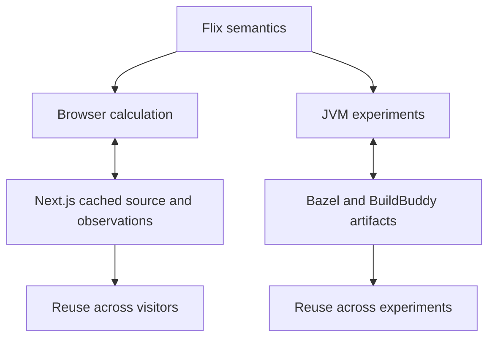

Attune turns repository relationships into small, inspectable programs. It separates the calculation from the expensive work it requests, so exact source analysis and model answers can be reused across questions, visitors, and experiments.

The project began by asking whether repository structure could make agent work cheaper and more reliable. Its experiments produced a more specific answer: reusable acquisition is valuable, structural evidence sometimes improves retrieval, and richer machinery does not automatically improve decisions.

Start with the [project story](/experiments/story), [run the offline example](/get-started/quickstart), or [read the architecture](/architecture/overview).

## One program, two execution models

Flix owns identities, admission, relationships, ranking, agent decisions, and evaluation. Native tools acquire syntax observations. Next.js distributes public artifacts to the browser. Bazel declares and schedules scientific work. Native Datalog remains JVM-only.

## What the evidence says

| Question | Consequential result |
| --- | --- |
| Does structure improve localization? | Mixed: additive structural scores regressed; prepared hosted reranking improved on the retained cohort. |
| Does structural context improve review efficiency? | Not demonstrated: all three optional packet calls were refused. |
| Do more structural patterns improve the default? | Individual recoveries exist; the established Studio recipe was stronger overall. |
| Should each repository get its own policy? | Cross-fitted specialization beat Qwen but lost to fixed Studio with fallback. |
| Can uncached extraction get cheaper? | The selected native build reduced the largest fixture's median from 37.54 to 12.24 seconds. |

The [experiment chapters](/experiments/story) keep populations, corrections, failures, and missing measurements beside the results. The [evidence guide](/experiments/evidence) explains how to inspect them.

[Source repository](https://github.com/becker63/attune) · [Retained research viewer](https://atlas-live-five.vercel.app/)

## Sources

[README.md](https://github.com/becker63/attune/blob/d71e033/README.md) · [LOCALIZATION_REPORT.md](https://github.com/becker63/attune/blob/d71e033/LOCALIZATION_REPORT.md)
